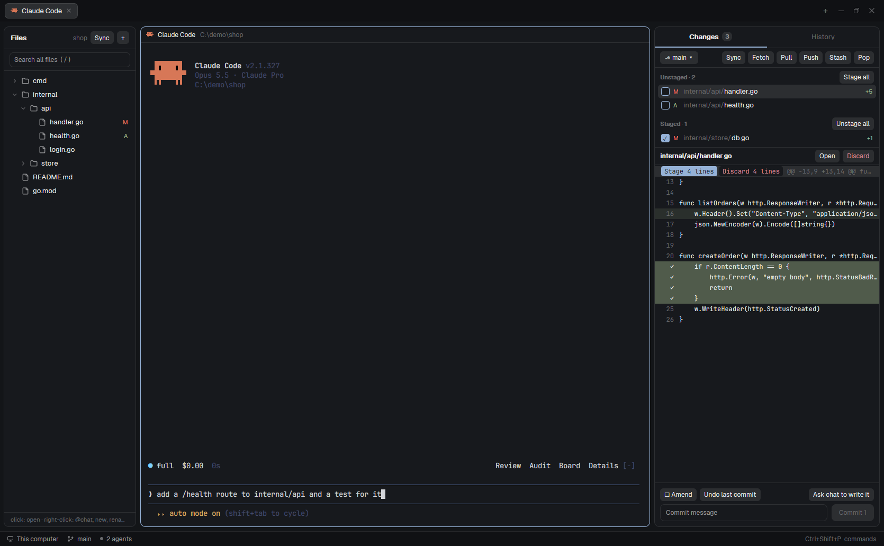
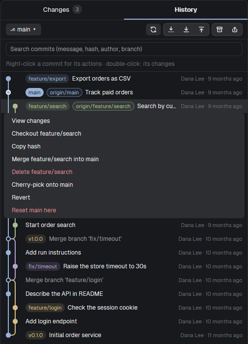

# my-herdr-app

A layout for [herdr-app](https://herdr.dev) (the desktop app) that puts a git
client around your chat pane. It is the desktop version of
[my-herdr](https://github.com/SeniolisFrame/my-herdr), the plugin for the herdr TUI:

```
 Files            │ chat (your agent) │ Changes
 file tree, edit, │                   │ stage files or hunks, commit,
 search, blame,   │                   │ branches, merge, pull, push,
 history          │                   │ stash, history graph
```



Both panels follow the focused pane's folder. These are native herdr-app panels
(GPUI), so Thai text renders correctly, the mouse works everywhere, and files open
in a real editor.

## Install

### What you need

- **herdr-app 0.1.16 or newer**, started at least once (that creates
  `~/.config/herdr-app`), with `herdr-app` on your PATH: `herdr-app --version`
  should answer in a terminal.
- **git** on your PATH: `git --version`.
- For Pull and Push: credentials that work without a prompt (Git Credential
  Manager, which comes with Git for Windows, or an ssh key in ssh-agent). Try a
  `git pull` in a terminal once; if that asks nothing, the panel works too.

### Windows

In PowerShell, with herdr-app running:

```powershell
git clone https://github.com/SeniolisFrame/my-herdr-app
cd my-herdr-app
powershell -ExecutionPolicy Bypass -File install.ps1
```

It prints `Installed.` and the window switches to the my-herdr layout: Files on
the left, your terminal in the middle, Changes on the right.

`install.ps1` copies `mods/my-files` and `mods/my-changes` into
`~/.config/herdr-app/mods` (test files left out), checks both mods with
`herdr-app check`, copies `layouts/my-herdr.json` into `~/.config/herdr-app/layouts`
and switches to it. If herdr-app keeps its files elsewhere, set `HERDR_APP_HOME`
to that folder first.

### macOS and Linux

`install.ps1` is for Windows. Copy the same files by hand:

```sh
git clone https://github.com/SeniolisFrame/my-herdr-app
cd my-herdr-app
APP="${HERDR_APP_HOME:-$HOME/.config/herdr-app}"
for m in my-files my-changes; do
  mkdir -p "$APP/mods/$m"
  cp shared/common.js mods/$m/*.js mods/$m/*.svg mods/$m/mod.json "$APP/mods/$m/"   # not the *.test.mjs files
  [ -d mods/$m/icons ] && cp -r mods/$m/icons "$APP/mods/$m/"
  herdr-app check "$APP/mods/$m"     # must say: check passed
done
cp layouts/my-herdr.json "$APP/layouts/"
herdr-app do layout.switch --name my-herdr
```

### Your own setup stays

Your layouts, keys and settings are not changed. `ctrl+shift+L` cycles layouts, so
you can go back to herdr's `main` and return. If the window ever looks broken,
`ctrl+alt+shift+escape` always goes back to the default layout.

### Update

```sh
cd my-herdr-app
git pull
powershell -ExecutionPolicy Bypass -File install.ps1   # macOS/Linux: the copy steps above
```

herdr-app reloads the copied files at once; no restart. It doesn't see edits made
in the repo until you install again (it watches its own folder, not links).

### Uninstall

On Windows, this removes both mods and the layout and switches back to `main`
(the repo folder stays):

```powershell
powershell -ExecutionPolicy Bypass -File uninstall.ps1
```

On macOS and Linux:

```sh
APP="${HERDR_APP_HOME:-$HOME/.config/herdr-app}"
herdr-app do layout.switch --name main
rm -rf "$APP/mods/my-files" "$APP/mods/my-changes" "$APP/layouts/my-herdr.json"
```

### If something goes wrong

- **`herdr-app folder not found`**: start herdr-app once, then run it again.
- **`herdr-app` is not recognized**: herdr-app isn't on PATH; add its folder to
  PATH, or open a new terminal after installing it.
- **`check failed: my-files` (or my-changes)**: the output under it says why. Most
  often herdr-app is older than 0.1.16: update it.
- **running scripts is disabled**: use the `powershell -ExecutionPolicy Bypass
  -File ...` line as written, not `.\install.ps1`.
- **The panels show your home folder, not the project**: they follow the focused
  terminal's folder (a `cd` there moves them at once). An agent started in your
  home folder (`claude` run in `~`) stays there whatever it does inside, so `cd`
  into the project before starting it, or start the workspace in the project folder.
- **Changes says "Not a git repository"**: the folder isn't inside a git repo.
- **Pull/Push fails asking for a password**: set up Git Credential Manager or an
  ssh key (see What you need).

## Use

### Files (left)

- Click a folder to open it, a file to edit it. A folder opened once (and the
  folders inside the one you open) shows at once next time. `ctrl+s` saves, `←` closes it (it
  asks first when there are unsaved edits), `esc` goes to the chat.
  Files keep their line endings (CRLF stays CRLF). When the open file changes on disk
  (a discard in Changes, the chat editing it), it shows the new text, unless you
  have unsaved edits: Save then refuses, so nothing is overwritten. Files over 400 KB and files on
  other machines open read-only.
- `ctrl+f` finds in the file. `ctrl+h` (or **Replace**) adds a replace box:
  **Next** replaces the found text under the cursor and finds the next one,
  **All** replaces every one in the file (then Save).
- Tab-indented files (Go) show their tabs as 4 spaces (the editor draws a tab as
  nothing) and are saved with tabs again.
- **Search all files** (`/`): every text file, tracked or not; click a hit to open
  the file at that line.
- **Replace across files**: after a search, type the new text under it and
  **Replace all**, or **Replace** on one hit. It replaces the search text (any
  case) on the matched lines only, and skips a file that changed since the search
  or is over 400 KB.
- **Right-click** a file or folder: **@ chat**, **New file**, **New folder**,
  **Rename**, **Delete** (click twice). **+** in the header does New file / New
  folder in the top folder. On this computer only.
- **Blame**: who changed each line; click a line to see that commit's change.
- **History**: the file's commits; click one to see its change.
- Select code in the open file and **right-click → Send to chat**: it types the
  file and lines (`src/a.go:12-18`) and the code in a code block into the chat.
- **@ chat** types `@path ` into the chat (the agent in this tab, else the focused
  terminal) without Enter. It goes through the clipboard and puts your clipboard
  back. Dragging a file onto a terminal pastes its full path.
- A letter shows git status: `M` modified, `A` new, `D` deleted, `U` conflict.

### Changes (right)

- Two tabs across the top: **Changes** (with the number of changed files) and
  **History**.
- Stage, unstage and commit move the files at once; git catches up
  behind (and puts them back if it refuses: a failed commit keeps its message).
  Every file's diff is read with the list, so clicking a file shows it at once.
- Two lists: **Unstaged** and **Staged**. A file that is partly staged
  is in both. The box moves a file from one list to the other; **Stage all** /
  **Unstage all**.
- Click a file to see its diff: an unstaged file shows what isn't staged yet, a
  staged one shows what is. Right-click a changed (`+` / `-`) line for its hunk's **Stage hunk** (or
  **Unstage hunk**) and **Discard hunk**. Click `+` / `-` lines to pick them: the
  menu then says **Stage 2 lines** and stages only those. **Discard hunk** (or
  **Discard 2 lines**, click twice) throws them out of the file; what is staged
  stays, and the file keeps its line endings.
- **Open** (or double-click the file) opens it in Files. **Discard** throws away
  the file's changes (click twice).
- Type a message and **Commit** (commits what is staged).
  - **Amend**: the next Commit rewrites the last commit; its message is filled in
    to edit, and whatever is staged goes into it too.
  - **Undo last commit** (click twice): the last commit's changes go back to
    Staged and its message back in the box. It warns when that commit is already
    pushed.
  - **Ask chat to write it**: types a request into the chat for the agent to read
    the staged diff and save a message to `.git/MY_HERDR_COMMIT_MSG`. Press Enter
    in the chat; the message shows up in the box when the agent saves it.
- **⎇ branch**: check out a local or remote branch, create one, or **Merge into
  current**. **Fetch**, **Pull**, **Push** (a new branch is pushed to `origin`),
  **Stash** (untracked files too), **Pop**.
- Conflicts (after a merge, pull, stash pop, cherry-pick or revert): the file shows
  `!` and its text with the conflict markers. Take **Ours** or **Theirs**, or edit
  it in Files and click **Mark resolved**; then Commit (an empty message uses
  git's). **Abort** undoes the whole operation.
- **History** tab: the graph of all branches: one color per line,
  curves where branches split and merge, branch labels (the current branch filled,
  remote branches outlined in the line's color, tags in yellow), a hollow dot for
  merge commits. It shows 50 commits at a time (**Show 50 more** at the bottom). It
  is read ahead when the repo first shows and kept as it is: opening it again reads
  nothing; it is read again after an action that changes it (commit, merge, checkout,
  pull, stash...) or on **Sync**. Picking a commit reads its changes ahead too.
  The search box filters the last 500 commits by message, hash, author or branch. Click a commit for its actions: **View changes**, **Checkout**,
  **Merge … into** and **Delete** for each branch on it (a branch with commits no
  other branch has asks again as **Force delete**), **Checkout commit** / **Merge**
  for a commit with no branch, **Cherry-pick onto** the current branch, **Revert**,
  **Copy hash**. Double-click opens its changes.

  

Both panels update when files change in the folder (and after their own actions);
there is no timer. **Sync** reads everything again. Each workspace, and each tab in
it, keeps its own panels (open file, open folders, selected change): switching back
shows them at once and refreshes behind. Switching away mid-load doesn't wait for it:
the load finishes in the background and is kept for when you come back.

Keys when the panel has focus: `↑` `↓` select, `space` stage or unstage, `o` open
in Files, `c` commit message, `l` history, `s` send `@path`, `esc` back (or to the
chat).

### Commands

Both panels take commands, so you can bind keys in `~/.config/herdr-app/keys.json`
or script them: `herdr-app do my-changes.pull`.

- `my-files.<cmd>`: `sync`, `toggle:<folder>`, `open:<path>[:<line>]`, `save`, `close`, `find:<text>`,
  `replace-in-file:<text>|<new>`, `search:<text>`, `replace-all:<new>`, `blame`,
  `history`, `send[:<path>]`, `send-code`, `type:<text>`, `menu:<path>` then `new-file:<name>`,
  `new-folder:<name>`, `rename:<name>` or `delete` (twice)
- `my-changes.<cmd>`: `sync`, `select:<path>` (or `select:staged:<path>` /
  `select:unstaged:<path>`), `stage`, `stage-all`, `unstage-all`, `hunk:<n>`,
  `discard-hunk:<n>` (twice), `line:<hunk>:<line>`, `discard`, `open`, `ours`, `theirs`, `commit[:<message>]`,
  `amend`, `undo` (twice), `ask`, `fetch`, `pull`, `push`, `stash`, `pop`, `abort`,
  `branches`, `checkout:<branch>`, `merge:<branch>`, `new-branch:<name>`,
  `delete-branch:<name>` (twice), `history`, `log-search:<text>`, `pick:<hash>`,
  `show:<hash>`, `cherry-pick:<hash>`, `revert:<hash>`

Example `keys.json` section:

```json
"mod:my-changes": { "ctrl-enter": "my-changes.commit", "alt-p": "my-changes.push" }
```

## Known limits

- Staging hunks and lines, saving, file actions and sending `@path` work on this
  computer only (not in a space on another machine).
- git runs without a terminal: pull and push need credentials that don't prompt in
  a terminal (Git Credential Manager, ssh-agent).
- History shows the last 500 commits; its search looks in those.
- Every git call starts a program (about 25 ms here, more on slow machines): the
  panels show what they expect first and read in the background, but an action
  still waits for its own git. Folders on this computer are listed in-process; a
  space on another machine lists them with sh (or PowerShell), which is slower.
- A file with both CRLF and LF line endings is saved with CRLF on every line.

## Code

Each panel's `main.js` holds the class (init, commands, refresh, keys, render); the
other files add its methods by job (`Object.assign(<Class>.prototype, ...)`).

| Path | What |
| --- | --- |
| `shared/common.js` | helpers both panels use (git, the chat, diff rows, buttons, text box, folder watch) |
| `mods/my-files/main.js` | Files: the class, commands, keys, drawing |
| `mods/my-files/tree.js` | listing folders (in-process here, sh or PowerShell on another machine) and the refresh |
| `mods/my-files/editor.js` | the open file: edit, save, find, replace, blame, history |
| `mods/my-files/actions.js` | search and replace across files, @path, new / rename / delete |
| `mods/my-files/icons.js`, `icons/` | which icon a file or folder gets; the icons are [Material Icon Theme](https://github.com/material-extensions/vscode-material-icon-theme)'s (MIT) (test: `node mods/my-files/icons.test.mjs`) |
| `mods/my-files/text.js` | tab ↔ space indents and replacing text (test: `node mods/my-files/text.test.mjs`) |
| `mods/my-changes/main.js` | Changes: the class, commands, status refresh, the diff, keys |
| `mods/my-changes/actions.js` | stage, discard, commit, remote, stash, branches |
| `mods/my-changes/history.js` | the History graph and a commit's changes |
| `mods/my-changes/view.js` | drawing: tabs, toolbar, lists, diff, branch menu, commit box |
| `mods/my-changes/status.js` | limits and the status-list helpers |
| `mods/my-changes/patch.js` | patches for staging hunks and single lines (test: `node mods/my-changes/patch.test.mjs`) |
| `mods/my-changes/graph.js` | history graph lanes (test: `node mods/my-changes/graph.test.mjs`) |
| `layouts/my-herdr.json` | herdr's `main` layout with Files left and Changes right |
| `install.ps1`, `uninstall.ps1` | copy into / remove from `~/.config/herdr-app` |

A mod can't import from outside its own folder, so `install.ps1` copies
`shared/common.js` into both mods (in the repo too; git ignores those copies). Edit
`shared/common.js`, never `mods/*/common.js`, then run `install.ps1`: it checks both
mods with `herdr-app check` and stops if one fails.
